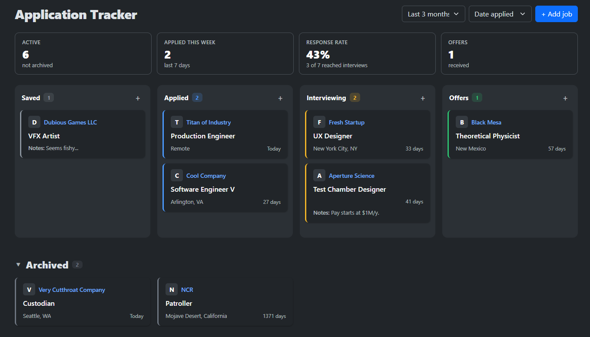

# Job Application Tracker

A web app for keeping track of a job search. Save postings, log applications, and move each one across a board as it goes from saved to applied, interviewing, offer, or archived.

You can check out a live deployment of the project [here](https://job-tracker-bwcqc3etb8ggd9g9.westus3-01.azurewebsites.net)



## Features

- **Kanban board.** Drag cards between stages (Saved, Applied, Interviewing, Offer Received, Archived), filtered by how recently each job was updated.
- **Sorting.** Order the cards in each column by last update, date applied, or title. Each card's date label follows the sort: time in current status, time since applying, or none for title.
- **Notes.** Keep free-form notes on each application. The start of the notes shows on its card.
- **Summary stats.** Active applications, applications this week, response rate, and offers.
- **Autofill from a link.** Paste a Greenhouse or Workday posting URL to fill in the title, company, location, and posted date.
- **Status history.** Each application records when its status changed.
- **Accounts.** Sign up with ASP.NET Core Identity; each user sees only their own applications.

## Tech stack

- ASP.NET Core MVC on .NET 10
- Entity Framework Core with SQL Server
- ASP.NET Core Identity
- Bootstrap 5 and vanilla JavaScript
- xUnit for unit and integration tests
- GitHub Actions builds, tests, and deploys to Azure App Service on every push to `main`

## Running locally

Requires the [.NET 10 SDK](https://dotnet.microsoft.com/download) and SQL Server (LocalDB, Express, or Developer edition).

```bash
git clone https://github.com/rodazzolin/Job-Application-Tracker.git
cd Job-Application-Tracker/JobTracker

# Install the EF Core CLI if you don't have it
dotnet tool install --global dotnet-ef

# Create the database (connection string is in appsettings.json)
dotnet ef database update

dotnet watch
```

The default connection string points to `localhost` with Windows authentication. Change `ConnectionStrings:DefaultConnection` in `appsettings.json` (or use user secrets) if your setup is different.

## Tests

```bash
dotnet test
```

CI runs only the unit tests (`--filter "FullyQualifiedName~JobTracker.Tests.Unit"`); the integration tests need a local SQL Server.
